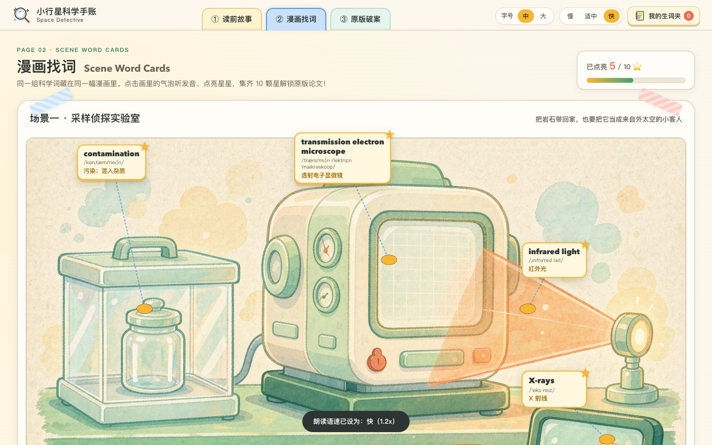
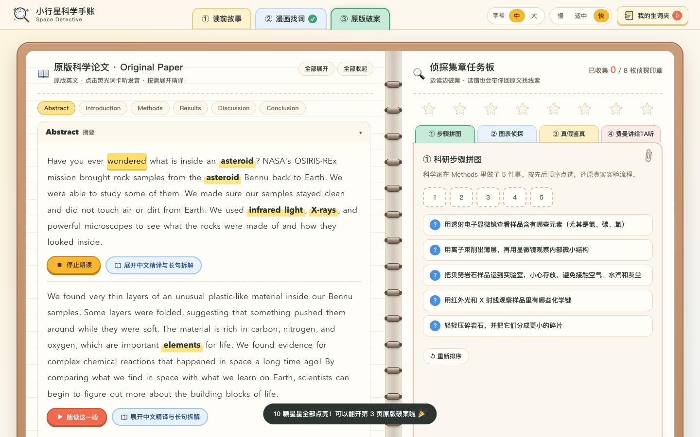
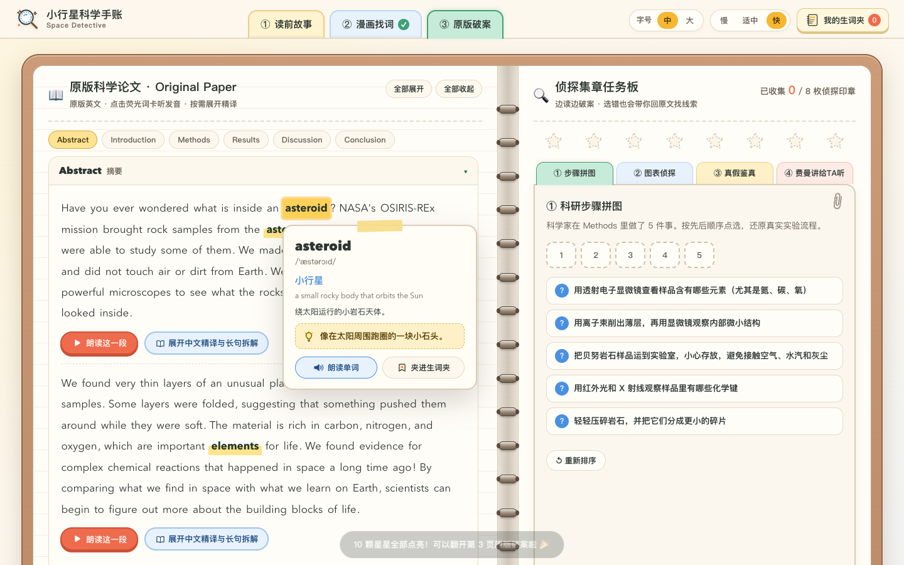
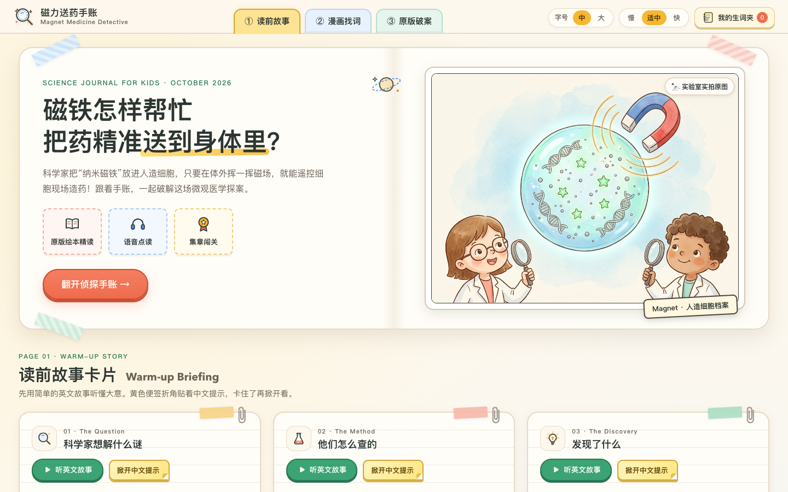
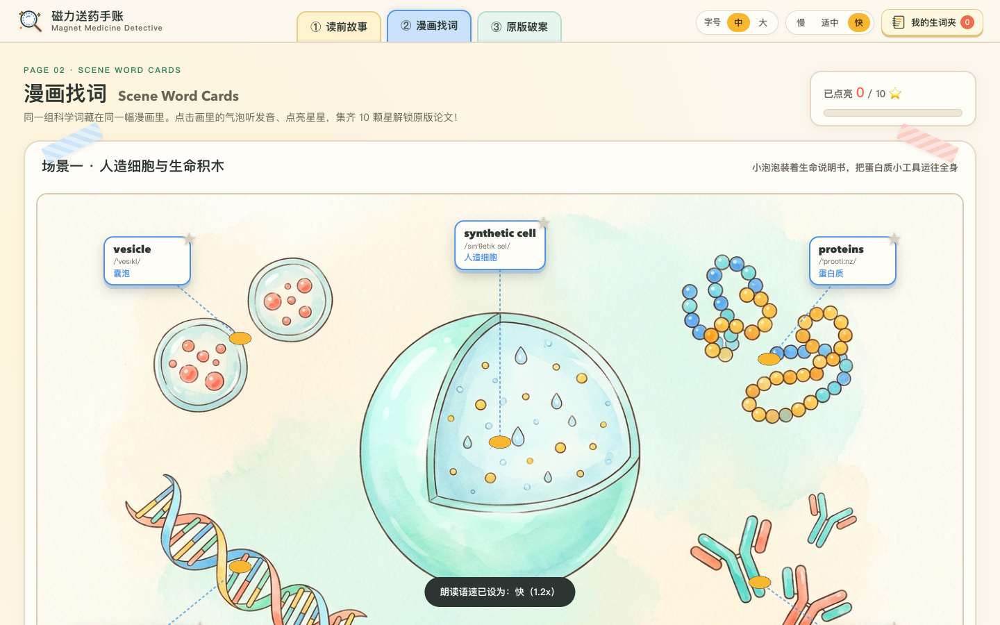
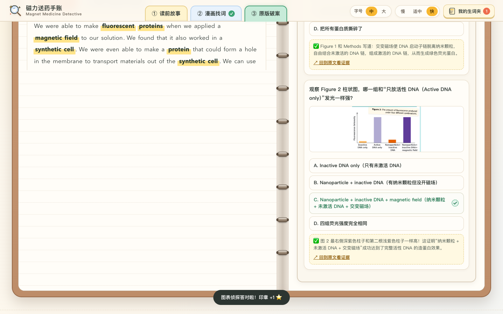

<div align="center">

# Kids Science Notebook

**Turn any *Science Journal For Kids* PDF into an offline, child-friendly interactive Storybook Science Notebook web app.**

[English](README.md) · [简体中文](README.zh-CN.md)

[](LICENSE)
[](#features)
[](#features)

</div>

---

## What is Kids Science Notebook?

**Kids Science Notebook** is an end-to-end Agent Skill (`SKILL.md` + Python/Node toolchain + HTML/CSS/JS template) that transforms a real scientific paper PDF from [*Science Journal For Kids*](https://www.sciencejournalforkids.org) into a standalone, zero-dependency bilingual learning web app designed specifically for children aged **8–13**.

Just drop a PDF and ask your AI coding agent — it handles text & vector diagram extraction, kid-friendly warm-up writing, watercolor scene cards, unified neural voice synthesis with word-by-word karaoke highlighting, interactive detective missions, automated browser verification, and `.zip` packaging.

---

## Features

- **Warm Storybook Paper UI (Scheme B)**: Eye-friendly `#FDF8EE` watercolor paper desk, pastel washi tape, paperclips, folded sticky-note translation toggles, `中 / 大` font size switcher, and `慢 / 适中 / 快` reading speeds.
- **3-Tab Notebook Flow (No Long-Page Overwhelm)**:
  - **① 读前故事 (Warm-up Stories)**: 3 ruled index cards summarizing *The Question*, *The Method*, and *The Discovery* in accessible English with expandable Chinese help.
  - **② 漫画找词 (Scene Word Cards)**: 2 illustrated text-free science scenes (5 terms each) with clickable audio bubbles, pointer lines, and a 10-star unlock meter.
  - **③ 原版破案 (Open Two-Page Spiral Reader & Missions)**: Left page shows the verbatim English paper with Polaroid-framed PDF figures; right page hosts an 8-stamp detective board (Method ordering, Figure Quiz, True/False with evidence jump-back, Feynman reflection, and printable certificate).
- **Word-by-Word Karaoke Read-Along & Tap-to-Read Every Word**:
  - Uses **Microsoft Edge TTS** (`en-US-AriaNeural` by default) to generate narration MP3s with native `WordBoundary` millisecond timestamps **plus** individual MP3s for every English word in the lesson.
  - Highlights each word as it is spoken; clicking any ordinary word speaks it immediately in the exact same neural voice, and clicking any highlighted core term opens a pure-SVG sticky-note card and auto-pronounces it.
- **100% Offline & Zero Server Needed**: Compiles data into `window.LESSON_DATA` and `window.AUDIO_TIMINGS` so double-clicking `index.html` works directly via `file://`.

---

## Showcase Examples

### Example 1 · Space Detective (`Bennu Asteroid`)
> Source: *Science Journal For Kids (Nov 2026)* — *"What clues does an asteroid hold about life on Earth?"*

| Page 1 · Storybook Cover & Warm-up Cards | Page 2 · Scene Word Cards |
| :---: | :---: |
|  |  |

| Page 3 · Open Spiral Reader (Live Karaoke Word Highlight) | Pure-SVG Sticky-Note Term Popup & Auto-Pronounce |
| :---: | :---: |
|  |  |

---

### Example 2 · Magnet Medicine Detective (`Synthetic Cells`)
> Source: *Science Journal For Kids (Oct 2026)* — *"How can magnets help deliver medicines?"*

| Page 1 · Storybook Cover & Warm-up Cards | Page 2 · Scene Word Cards (Synthetic Cell) |
| :---: | :---: |
|  |  |

| Page 3 · Open Spiral Reader & Figure Detective Mission |
| :---: |
|  |

---

## How to Use (For New Users)

### 1. Prerequisites

- **Python / `uv`**: [`uv`](https://docs.astral.sh/uv/) installed (`pymupdf` and `edge-tts` are fetched automatically on demand via `uv run`).
- **Node.js + Playwright + Chrome** *(for automated verification in Stage 6)*: Local Google Chrome and `playwright` npm package.
- **Image Generator** *(optional, for Stage 3)*: Your AI agent's image generation tool (or custom watercolor illustrations placed at `assets/ui/hero_cover.png` and `assets/scenes/scene_{1,2}.jpg`).

### 2. Install the Skill

Clone this repository into your global Antigravity skills folder (or your workspace `.agents/skills/`):

```bash
git clone https://github.com/chaogevision/kids-science-notebook.git \
  ~/.gemini/config/skills/kids-science-notebook
```

### 3. Generate a New Learning Webpage with Your AI Agent

1. Download any article PDF from [*Science Journal For Kids*](https://www.sciencejournalforkids.org).
2. Upload or pass the PDF path to your AI agent and say:
   > **"Use `kids-science-notebook` to turn this PDF into a kids' science interactive learning webpage."**
3. The agent automatically runs all 6 stages and delivers an offline folder (`index.html`) plus a shareable `.zip` bundle.

### 4. Manual CLI Workflow (For Developers)

```bash
SKILL=~/.gemini/config/skills/kids-science-notebook

# Stage 1: Extract verbatim PDF text, bitmaps & high-DPI page renders
uv run --with pymupdf python3 "$SKILL/scripts/extract_pdf.py" \
  extract /path/to/article.pdf ./_pdf_extract

# Optional: Crop a vector diagram cleanly from page N (normalized 0..1 box)
uv run --with pymupdf python3 "$SKILL/scripts/extract_pdf.py" \
  crop /path/to/article.pdf --page 2 --box 0.03 0.63 0.97 0.945 \
  --out ./my-notebook/assets/figures/figure1.png

# Stage 2 & 3: Scaffold template, write data/lesson_data.json (see references/lesson_schema.md),
# and place hero_cover.png + scene_1.jpg + scene_2.jpg
python3 "$SKILL/scripts/build_project.py" ./my-notebook --init-only

# Stage 4: Compile lesson_data.js & validate all referenced image assets
python3 "$SKILL/scripts/build_project.py" ./my-notebook

# Stage 5: Generate Edge TTS narrations, WordBoundary timings & tap-to-read word MP3s
uv run --with edge-tts python3 "$SKILL/scripts/generate_audio.py" ./my-notebook

# Stage 6: Run headless Chrome offline tests & package ready-to-share .zip
node "$SKILL/scripts/verify_app.mjs" ./my-notebook
python3 "$SKILL/scripts/build_project.py" ./my-notebook --zip ./my-notebook-offline.zip
```

---

## Repository Structure

```text
kids-science-notebook/
├── SKILL.md                      # 6-stage agent workflow instructions
├── README.md                     # Documentation (English)
├── README.zh-CN.md               # Documentation (简体中文)
├── LICENSE                       # MIT License
├── references/
│   └── lesson_schema.md          # lesson_data.json schema & pedagogy guide
├── scripts/
│   ├── extract_pdf.py            # PyMuPDF text, bitmap & vector-crop extractor
│   ├── build_project.py          # Template sync, lesson_data.js compiler & .zip packager
│   ├── generate_audio.py         # Edge TTS WordBoundary timings + all word MP3s
│   └── verify_app.mjs            # Headless Chrome offline verification suite
├── docs/screenshots/             # Real captures from the two showcase projects
└── assets/template/              # Reusable Scheme B HTML/CSS/JS + 18 SVG icons
```

---

## License

Released under the [MIT License](LICENSE).
