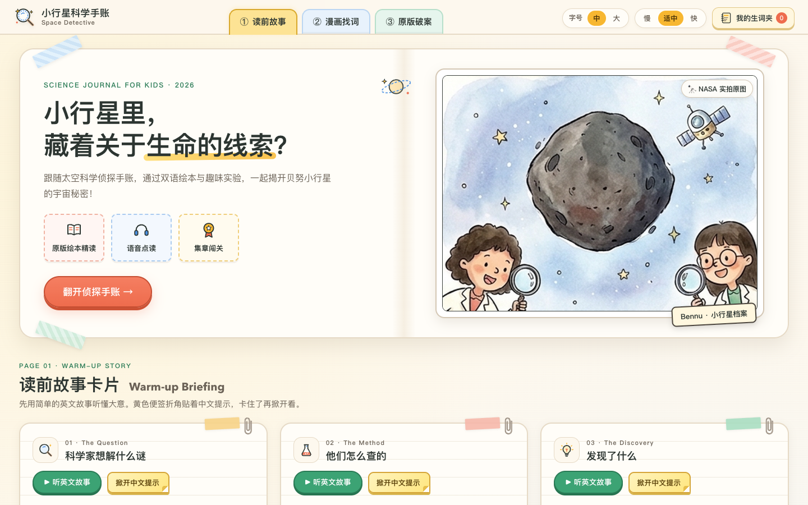

<div align="center">

# Kids Science Notebook

**Turn any *Science Journal For Kids* PDF into an offline, child-friendly interactive Storybook Science Notebook web app.**

[English](README.md) · [简体中文](README.zh-CN.md)

[](LICENSE)
[](#features)
[](#features)

</div>

---

## What is Kids Science Notebook?

**Kids Science Notebook** is an end-to-end Agent Skill (`SKILL.md` + Python/Node toolchain + HTML/CSS/JS template) that transforms a real scientific paper PDF from [*Science Journal For Kids*](https://www.sciencejournalforkids.org) into a standalone, zero-dependency bilingual learning web app designed specifically for children aged **8–13**.

Just drop a PDF and ask your AI coding agent — it handles text & vector diagram extraction, kid-friendly warm-up writing, watercolor scene cards, unified neural voice synthesis with word-by-word karaoke highlighting, interactive detective missions, automated browser verification, and `.zip` packaging.

---

## Features

- **Warm Storybook Paper UI (Scheme B)**: Eye-friendly `#FDF8EE` watercolor paper desk, pastel washi tape, paperclips, folded sticky-note translation toggles, `中 / 大` font size switcher, and `慢 / 适中 / 快` reading speeds.
- **3-Tab Notebook Flow (No Long-Page Overwhelm)**:
  - **① 读前故事 (Warm-up Stories)**: 3 ruled index cards summarizing *The Question*, *The Method*, and *The Discovery* in accessible English with expandable Chinese help.
  - **② 漫画找词 (Scene Word Cards)**: 2 illustrated text-free science scenes (5 terms each) with clickable audio bubbles, pointer lines, and a 10-star unlock meter.
  - **③ 原版破案 (Open Two-Page Spiral Reader & Missions)**: Left page shows the verbatim English paper with Polaroid-framed PDF figures; right page hosts an 8-stamp detective board (Method ordering, Figure Quiz, True/False with evidence jump-back, Feynman reflection, and printable certificate).
- **Word-by-Word Karaoke Read-Along & Tap-to-Read Every Word**:
  - Uses **Microsoft Edge TTS** (`en-US-AriaNeural` by default) to generate narration MP3s with native `WordBoundary` millisecond timestamps **plus** individual MP3s for every English word in the lesson.
  - Highlights each word as it is spoken; clicking any ordinary word speaks it immediately in the exact same neural voice, and clicking any highlighted core term opens a pure-SVG sticky-note card and auto-pronounces it.
- **Offline-first delivery (desktop)**: Compiles data and audio metadata into local scripts, so a complete, extracted notebook is designed to open directly via `file://` in a compatible desktop browser. Generation, dependency installation and Edge TTS require network access. Tablet simulation does not establish iPadOS Safari compatibility.

---

## Showcase Examples

The repository contains screenshots of these two projects, not their complete runnable lesson data, images or audio packages. Screenshots alone do not establish cross-platform or physical-device acceptance.

### Example 1 · Space Detective (`Bennu Asteroid`)
> Source: *Science Journal For Kids (Nov 2026)* — *"What clues does an asteroid hold about life on Earth?"*

| Page 1 · Storybook Cover & Warm-up Cards | Page 2 · Scene Word Cards |
| :---: | :---: |
|  |  |

| Page 3 · Open Spiral Reader (Live Karaoke Word Highlight) | Pure-SVG Sticky-Note Term Popup & Auto-Pronounce |
| :---: | :---: |
|  |  |

---

### Example 2 · Magnet Medicine Detective (`Synthetic Cells`)
> Source: *Science Journal For Kids (Oct 2026)* — *"How can magnets help deliver medicines?"*

| Page 1 · Storybook Cover & Warm-up Cards | Page 2 · Scene Word Cards (Synthetic Cell) |
| :---: | :---: |
|  |  |

| Page 3 · Open Spiral Reader & Figure Detective Mission |
| :---: |
|  |

---

## How to Use (For New Users)

### 1. Prerequisites and installation

The generation toolchain is intended for macOS, Windows (PowerShell) and Linux. Install [Git](https://git-scm.com/), [`uv`](https://docs.astral.sh/uv/), and [Node.js](https://nodejs.org/) 20+ (a supported LTS release is recommended). The generated notebook does not require Python or Node.js on the learner's device. Provide an image generation tool or the required illustrations yourself.

Clone into any directory you can access. If using an Agent's Skill discovery folder, follow that Agent's current installation instructions; no global path is required. All commands below assume you are in the directory containing `SKILL.md`. The same single-line commands work in PowerShell, bash and zsh.

```sh
git clone https://github.com/chaogevision/kids-science-notebook.git
cd kids-science-notebook
uv python install 3.11
npm install
npx playwright install chromium
```

Playwright is installed locally in the skill, not globally. On Linux, if required system libraries are missing, use `npx playwright install --with-deps chromium` (administrator permission may be required). Network access is needed for installing dependencies, downloading Chromium and synthesizing Edge TTS audio.

By default, verification launches Playwright's managed Chromium. To use an existing compatible Chromium/Chrome executable, set the optional `CHROMIUM_EXECUTABLE_PATH` environment variable to its actual executable path (not a directory). Examples; replace the paths with your own:

```bash
# macOS / Linux
export CHROMIUM_EXECUTABLE_PATH="/actual/path/to/chromium"
```

```powershell
# Windows PowerShell
$env:CHROMIUM_EXECUTABLE_PATH = 'C:\actual\path\to\chrome.exe'
```

Unset it to return to the managed browser (`unset CHROMIUM_EXECUTABLE_PATH` on macOS/Linux; `Remove-Item Env:CHROMIUM_EXECUTABLE_PATH` in PowerShell).

### 2. Generate a notebook with your AI Agent

Download a PDF from [Science Journal For Kids](https://www.sciencejournalforkids.org). Give the Agent access to this Skill and the PDF, and ask:

> Use `kids-science-notebook` to turn this PDF into a kids' science interactive learning webpage.

The Agent should follow the six stages in [SKILL.md](SKILL.md), repair any failed checks, then deliver the extracted notebook and ZIP along with actual QA results and device limitations. An image generation tool or supplied illustrations and network access for Edge TTS are necessary during generation.

### 3. Manual CLI workflow (all three desktop platforms)

These examples use `../article.pdf`, `../my-notebook` and `../_pdf_extract` relative to the skill root. Substitute your actual paths and keep them quoted, including paths with spaces or non-ASCII characters. Run each command separately and stop on non-zero exit status. On PowerShell check `$LASTEXITCODE`; on bash/zsh check `$?`.

**Stages 1–3:** Extract the PDF, scaffold the project, and optionally crop a vector diagram (replace page and normalized box with actual values).

```sh
uv run --no-project --python 3.11 --with pymupdf python scripts/extract_pdf.py extract "../article.pdf" "../_pdf_extract"
uv run --no-project --python 3.11 python scripts/build_project.py "../my-notebook" --init-only
uv run --no-project --python 3.11 --with pymupdf python scripts/extract_pdf.py crop "../article.pdf" --page 2 --box 0.03 0.63 0.97 0.945 --out "../my-notebook/assets/figures/figure1.png"
```

Author `../my-notebook/data/lesson_data.json` according to [lesson_schema.md](references/lesson_schema.md). Put in the hero cover, two scenes and referenced figures. Inspect the generated images and bubble coordinates before continuing. All JSON image paths must be project-relative, case-exact, use forward slashes, and reference non-empty files that will be included in the ZIP.

**Stages 4–6:** Compile and validate the lesson, generate audio, run browser QA, and only after QA exits 0 and screenshots have been reviewed, package the ZIP outside the project folder.

```sh
uv run --no-project --python 3.11 python scripts/build_project.py "../my-notebook"
uv run --no-project --python 3.11 --with edge-tts python scripts/generate_audio.py "../my-notebook"
node scripts/verify_app.mjs "../my-notebook"
uv run --no-project --python 3.11 python scripts/build_project.py "../my-notebook" --zip "../my-notebook-offline.zip"
```

The builder exits non-zero on missing/invalid/empty image references and will not produce a new ZIP on failure. An earlier ZIP remains unchanged; do not mistake it for a fresh result. Image decodability and playback are checked in the browser stage; a ZIP command by itself is not an end-to-end acceptance test. Do not skip the verifier. `qa-*.png` captures are excluded from the ZIP.

For regression checks on the builder and verifier file handling, run `uv run --no-project --python 3.11 python -m unittest discover -s tests -v` and `node --test tests/test_verify_files.mjs` from the skill root.

## Device Compatibility and iPad Acceptance

- **Desktop macOS / Windows / Linux:** Intended build targets. Once a lesson passes QA, extract the entire ZIP and open `index.html` with a compatible desktop browser. Keep all files and folders together. The build instructions are portable; passing on one OS does not certify another OS or every browser.
- **Tablet layout simulation:** The verifier uses Chromium at 1194 × 834 with touch input, checks navigation and resource loading, and generates `assets/qa-ipad.png` and `assets/qa-tablet-reader.png`. These are simulated tablet captures, not tests of iPadOS, Safari, or the Files app.
- **Physical iPad:** Not verified by the evidence in this repository. Files/Quick Look may preview HTML rather than open a full browser page with its sibling resources. Do not promise offline double-click/Files-app support. If local opening fails, serve the same extracted directory over HTTP(S) and open the URL in Safari; this is an alternative delivery method and requires a connection to the host, not a guarantee of offline use.

For a same-network test, from the skill root run `uv run --no-project --python 3.11 python -m http.server 8000 --bind 0.0.0.0 --directory "../my-notebook"`, then open `http://YOUR_COMPUTER_LAN_IP:8000/` in Safari on the iPad. Use a trusted local network and stop the server after testing. If LAN access is unavailable, use an approved static HTTP(S) hosting method instead.

**Physical iPad acceptance checklist:** Record device model, iPadOS and browser versions, test date, lesson, and delivery method (extracted local folder vs HTTP(S)). Check the cover, all three pages, image decoding, vocabulary touch targets and progress, Chinese aid/font/speed controls, actual MP3 playback and word highlighting, term popup/notebook, all four missions and certificate, and landscape/portrait layout. For a claim of fully offline support, disable Wi-Fi/cellular and reopen the complete local lesson; verify the same items. Record pass/fail with captures and any limitations. A working HTTP(S) session is not proof of offline local-file access.

---

## Repository Structure

```text
kids-science-notebook/
├── SKILL.md                      # 6-stage agent workflow instructions
├── README.md                     # Documentation (English)
├── README.zh-CN.md               # Documentation (简体中文)
├── package.json                  # Local Playwright QA dependency
├── tests/                        # Builder regression tests
├── LICENSE                       # MIT License
├── references/
│   └── lesson_schema.md          # lesson_data.json schema & pedagogy guide
├── scripts/
│   ├── extract_pdf.py            # PyMuPDF text, bitmap & vector-crop extractor
│   ├── build_project.py          # Template sync, lesson_data.js compiler & .zip packager
│   ├── generate_audio.py         # Edge TTS WordBoundary timings + all word MP3s
│   ├── verify_files.mjs          # Local file checks / 本地文件校验
│   └── verify_app.mjs            # Headless Chromium offline verification suite
├── docs/screenshots/             # Real captures from the two showcase projects
└── assets/template/              # Reusable Scheme B HTML/CSS/JS + 18 SVG icons
```

---

## License

Released under the [MIT License](LICENSE).
