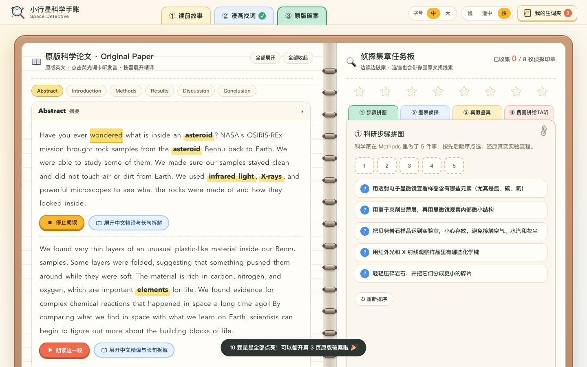
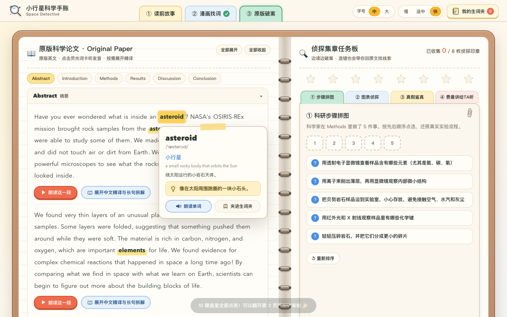

<div align="center">

# Kids Science Notebook · 儿童科普互动手账 Skill

**把任意一篇 *Science Journal For Kids* 科普论文 PDF，一键制作成可离线双击使用的「温暖绘本手账」儿童双语学习网页。**

[English](README.md) · [简体中文](README.zh-CN.md)

[](LICENSE)
[](#核心特性)
[](#核心特性)

</div>

---

## 项目简介

**Kids Science Notebook** 是一套端到端的可复用 Agent Skill（包含 `SKILL.md` 工作流规范、Python/Node 自动化脚本与完整网页模板）。它专门面向 **8–13 岁儿童**，将全英文原版科普期刊 [*Science Journal For Kids*](https://www.sciencejournalforkids.org) 的 PDF 论文，转化为兼具**护眼纸感绘本视觉、分级破冰故事、场景漫画找词、对开笔记本精读与侦探集章闯关**的交互式学习网页。

---

## 核心特性

- **方案 B「温暖绘本手账」视觉体系**：柔和暖米水彩纸底（`#FDF8EE`）、横线笔记卡片、斜纹和纸胶带、回形针、黄色折角「掀开中文提示」贴纸，并提供儿童友好的 **字号切换（`中 / 大`）** 与 **语速档位（`慢 / 适中 / 快`）**。
- **三页式手账页签结构（告别长页阅读压迫）**：
  - **① 读前故事**：3 张简化英文破冰故事卡片（想解什么谜 / 怎么查的 / 发现了什么），中文辅助默认收起、按需掀开。
  - **② 漫画找词**：2 幅无文字水彩场景图，共藏 10 个核心科学词汇，点击气泡听发音并点亮星星，集齐后解锁原版精读。
  - **③ 原版破案（对开活页手账）**：左页忠实保留原版英文论文，配拍立得贴纸式原论文图表与逐段中文精译/长难句拆解；右页是 8 枚侦探集章任务板（实验步骤拼图、图表侦探、真假鉴真带原文证据定位、费曼讲给 TA 听与可打印结业证书）。
- **Edge TTS 统一音色 + 逐词跟随高亮 + 全文任意词点读**：
  - 全部通过 **Edge TTS**（默认 `en-US-AriaNeural`，`-10%` 语速）合成整段朗读音频，并采集原生 `WordBoundary` 毫秒级时间轴。
  - 朗读到哪个单词，哪个单词实时高亮；点击正文任意普通英文词均可直接用同一音色点读发声；点击黄色荧光标记的核心词，同时弹出纯 SVG 图标的便利贴卡片并自动朗读。
- **面向桌面浏览器的离线交付**：将数据与音频元信息编译为本地脚本，完整解压后可尝试使用兼容桌面浏览器通过 `file://` 打开 `index.html`，并分享 `.zip` 包。生成阶段的依赖安装及 Edge TTS 需要联网；平板模拟并不代表已验证 iPadOS Safari。

---

## 成品案例展示（项目截图）

仓库中仅提供两套案例的截图，并未包含完整可运行的课程数据、图片及音频包。截图本身不构成跨平台或物理设备验收证据。

### 案例一 · 小行星科学手账（Space Detective）
> 原文：*Science Journal For Kids (Nov 2026)* — *《What clues does an asteroid hold about life on Earth?》*

| 第 1 页 · 绘本封面与读前故事卡 | 第 2 页 · 场景漫画找词 |
| :---: | :---: |
|  |  |

| 第 3 页 · 对开手账与逐词跟随高亮朗读 | 纯 SVG 图标词卡便利贴与点击自动发声 |
| :---: | :---: |
|  |  |

---

### 案例二 · 磁力送药手账（Magnet Medicine Detective）
> 原文：*Science Journal For Kids (Oct 2026)* — *《How can magnets help deliver medicines?》*

| 第 1 页 · 绘本封面与读前故事卡 | 第 2 页 · 人造细胞与磁控实验室词卡 |
| :---: | :---: |
|  |  |

| 第 3 页 · 对开手账精读与图表侦探闯关 |
| :---: |
|  |

---

## 新用户使用指南

### 1. 环境准备与安装

生成工具链面向 macOS、Windows（PowerShell）与 Linux。请安装 [Git](https://git-scm.com/)、[`uv`](https://docs.astral.sh/uv/) 和 [Node.js](https://nodejs.org/) 20+（建议使用仍受支持的 LTS 版本）。孩子使用已生成的手账时无需安装 Python 或 Node.js。生成插画需要 Agent 生图工具或自行提供插画。

可将仓库克隆到任意有访问权限的目录。如需 Agent 自动发现 Skill，请按照该 Agent 当前的安装规范放入相应目录，不要求固定全局路径。以下所有命令均在包含 `SKILL.md` 的仓库根目录执行，同一套单行命令适用于 PowerShell、bash 和 zsh。

```sh
git clone https://github.com/chaogevision/kids-science-notebook.git
cd kids-science-notebook
uv python install 3.11
npm install
npx playwright install chromium
```

Playwright 安装在 Skill 本地，无需全局 npm 安装。Linux 如果缺少系统浏览器库，可执行 `npx playwright install --with-deps chromium`（可能需要管理员权限）。安装依赖、下载 Chromium、合成 Edge TTS 音频需要联网。

验收默认启动 Playwright 管理的 Chromium。如果希望使用已有且兼容的 Chromium/Chrome，可选设环境变量 `CHROMIUM_EXECUTABLE_PATH`，指向实际浏览器可执行文件而非目录。以下仅为示例，请替换为自己的路径：

```bash
# macOS / Linux
export CHROMIUM_EXECUTABLE_PATH="/actual/path/to/chromium"
```

```powershell
# Windows PowerShell
$env:CHROMIUM_EXECUTABLE_PATH = 'C:\actual\path\to\chrome.exe'
```

取消该变量即可恢复默认浏览器（macOS/Linux：`unset CHROMIUM_EXECUTABLE_PATH`；PowerShell：`Remove-Item Env:CHROMIUM_EXECUTABLE_PATH`）。

### 2. 让 AI Agent 生成互动手账

从 [Science Journal For Kids](https://www.sciencejournalforkids.org) 下载感兴趣的 PDF，确保 Agent 有权访问本 Skill 和 PDF，再对它说：

> 用 `kids-science-notebook` 把这份 PDF 做成儿童科普互动网页。

Agent 应按 [SKILL.md](SKILL.md) 的六阶段工作流运行、修复验收失败项，再交付完整手账目录和 ZIP，同时说明实际 QA 结果与设备限制。生成阶段需要生图能力或自备插画，Edge TTS 合成需要联网。

### 3. 手动命令行工作流（三种桌面系统通用）

示例路径 `../article.pdf`、`../my-notebook` 和 `../_pdf_extract` 相对于 Skill 根目录。实际使用时请替换为自己的路径，保留引号以支持空格、中文路径。逐条执行命令，遇到非零退出码立即停止。PowerShell 检查 `$LASTEXITCODE`；bash/zsh 检查 `$?`。

**阶段 1–3：** 提取 PDF、初始化模板，并按需裁剪原论文矢量图表（页码和归一化坐标按实际修改）。

```sh
uv run --no-project --python 3.11 --with pymupdf python scripts/extract_pdf.py extract "../article.pdf" "../_pdf_extract"
uv run --no-project --python 3.11 python scripts/build_project.py "../my-notebook" --init-only
uv run --no-project --python 3.11 --with pymupdf python scripts/extract_pdf.py crop "../article.pdf" --page 2 --box 0.03 0.63 0.97 0.945 --out "../my-notebook/assets/figures/figure1.png"
```

根据 [lesson_schema.md](references/lesson_schema.md) 编写 `../my-notebook/data/lesson_data.json`，放入封面、两幅场景图及所有引用的论文图表。继续之前须检查插画和词汇气泡坐标。JSON 中图片必须使用项目内相对路径、正斜杠、大小写精确匹配，并指向会被打包的非空文件。

**阶段 4–6：** 编译并校验课程、生成音频、运行浏览器验收；只有验收退出码为 0 且截图人工复核通过后，才打包到项目目录外部。

```sh
uv run --no-project --python 3.11 python scripts/build_project.py "../my-notebook"
uv run --no-project --python 3.11 --with edge-tts python scripts/generate_audio.py "../my-notebook"
node scripts/verify_app.mjs "../my-notebook"
uv run --no-project --python 3.11 python scripts/build_project.py "../my-notebook" --zip "../my-notebook-offline.zip"
```

缺失、无效或空图片会使构建以非零状态退出，失败不会产出新的 ZIP。此前存在的 ZIP 将保持不变，不要将旧包误作本次成果。图片能否解码以及音频实际播放由浏览器阶段检查；单独运行 ZIP 命令不等于完成端到端验收，不可跳过验收脚本。`qa-*.png` 截图不会打入 ZIP。

构建器及验收器文件处理回归测试：在 Skill 根目录运行 `uv run --no-project --python 3.11 python -m unittest discover -s tests -v` 与 `node --test tests/test_verify_files.mjs`。

## 设备兼容性与 iPad 真机验收

- **macOS / Windows / Linux 桌面端：** 为预期构建目标。课程通过验收后，完整解压 ZIP，并用兼容桌面浏览器打开 `index.html`；不要单独移动 HTML。跨平台命令可用不等于已在每个系统和浏览器实测。
- **平板布局模拟：** 验收脚本使用 1194 × 834 的 Chromium 触控视口，检查页面导航及资源加载，生成 `assets/qa-ipad.png` 和 `assets/qa-tablet-reader.png`。这是模拟平板截图，不是 iPadOS、Safari 或「文件」App 真机测试。
- **物理 iPad：** 仓库尚无可证明真机支持的验收证据。「文件」App/快速查看可能仅预览 HTML，而不会完整访问同目录资源。不要承诺离线双击可用。如本地打开失败，可尝试将同一手账目录通过 HTTP(S) 提供给 Safari；这种方式需要与服务器连接，不等同于纯离线使用。

同一局域网测试：在 Skill 根目录执行 `uv run --no-project --python 3.11 python -m http.server 8000 --bind 0.0.0.0 --directory "../my-notebook"`，在 iPad Safari 打开 `http://YOUR_COMPUTER_LAN_IP:8000/`（替换为电脑实际局域网 IP）。仅在可信网络测试，结束后关闭服务器。如果局域网无法访问，可使用经许可的静态 HTTP(S) 托管方式。

**iPad 真机验收清单：** 记录机型、iPadOS 与浏览器版本、测试日期、课程和打开方式（本地解压目录或 HTTP(S)）。检查封面、三个页面、图片解码、触摸点词与进度、中文辅助/字号/语速、真实 MP3 播放和逐词高亮、词汇弹窗与生词夹、四项任务和证书、横竖屏布局。如果要声明完全离线支持，应关闭 Wi-Fi 和蜂窝网络后重新打开完整本地课程，逐项复测。记录通过/失败、截图和限制。HTTP(S) 打开成功不证明离线本地文件可用。

---

## 仓库目录结构

```text
kids-science-notebook/
├── SKILL.md                      # 6 阶段端到端执行手册
├── README.md                     # 英文说明文档
├── README.zh-CN.md               # 简体中文说明文档
├── package.json                  # 本地 Playwright 验收依赖
├── tests/                        # 构建器回归测试
├── LICENSE                       # MIT 开源协议
├── references/
│   └── lesson_schema.md          # lesson_data.json 数据规范与教研指南
├── scripts/
│   ├── extract_pdf.py            # PyMuPDF 文本、位图与矢量图裁剪工具
│   ├── build_project.py          # 模板同步、lesson_data.js 编译与 .zip 打包
│   ├── generate_audio.py         # Edge TTS 逐词时间轴与全词点读音频生成
│   ├── verify_files.mjs          # Local file checks / 本地文件校验
│   └── verify_app.mjs            # 无头 Chromium 离线全链路自动化验收脚本
├── docs/screenshots/             # 两套成品案例项目截图
└── assets/template/              # 方案 B 通用网页模板 + 18 枚手账 SVG 图标
```

---

## 开源协议

本项目基于 [MIT License](LICENSE) 开源。
