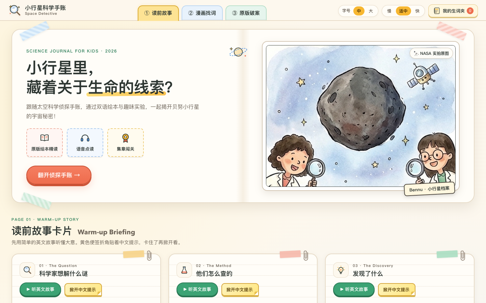
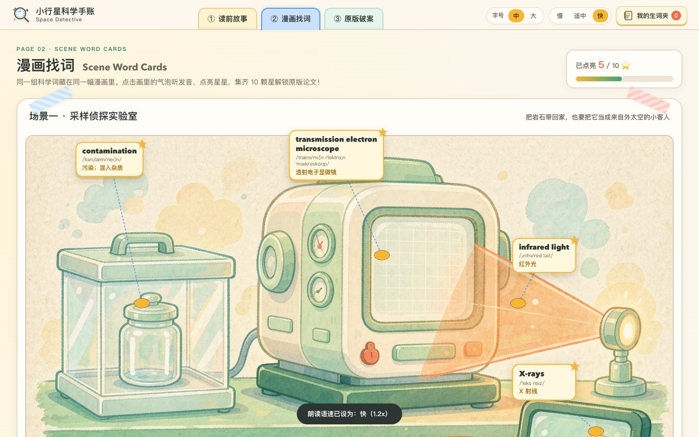
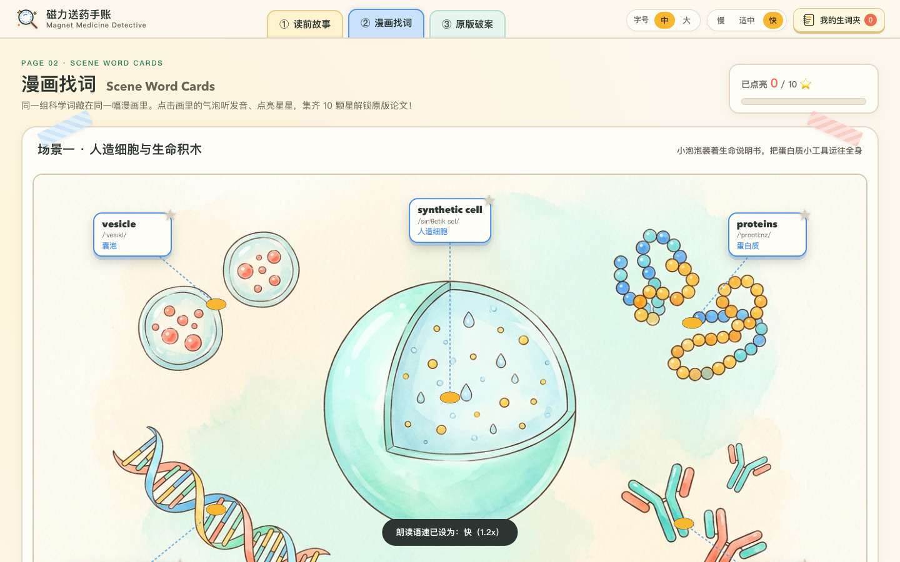
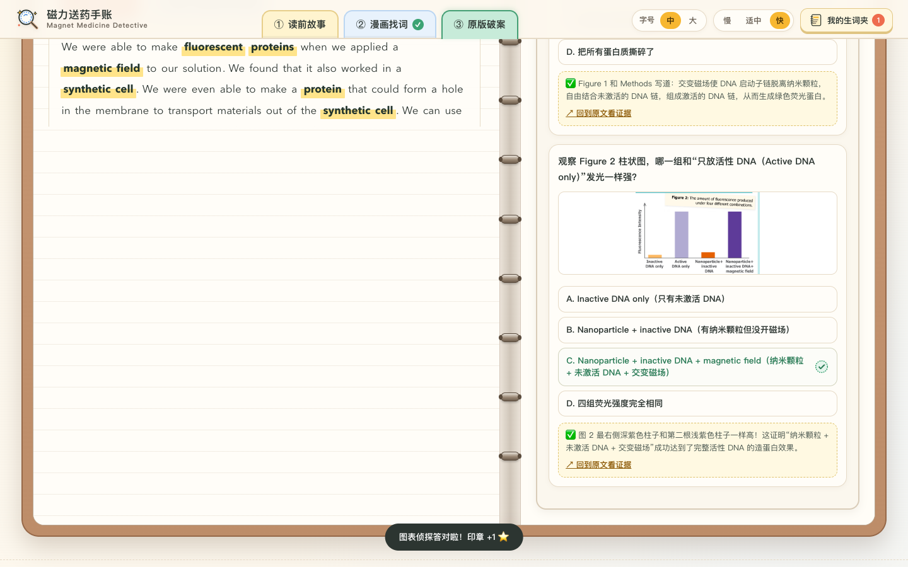

<div align="center">

# Kids Science Notebook · 儿童科普互动手账 Skill

**把任意一篇 *Science Journal For Kids* 科普论文 PDF，一键制作成可离线双击使用的「温暖绘本手账」儿童双语学习网页。**

[English](README.md) · [简体中文](README.zh-CN.md)

[](LICENSE)
[](#核心特性)
[](#核心特性)

</div>

---

## 项目简介

**Kids Science Notebook** 是一套端到端的可复用 Agent Skill（包含 `SKILL.md` 工作流规范、Python/Node 自动化脚本与完整网页模板）。它专门面向 **8–13 岁儿童**，将全英文原版科普期刊 [*Science Journal For Kids*](https://www.sciencejournalforkids.org) 的 PDF 论文，转化为兼具**护眼纸感绘本视觉、分级破冰故事、场景漫画找词、对开笔记本精读与侦探集章闯关**的交互式学习网页。

---

## 核心特性

- **方案 B「温暖绘本手账」视觉体系**：柔和暖米水彩纸底（`#FDF8EE`）、横线笔记卡片、斜纹和纸胶带、回形针、黄色折角「掀开中文提示」贴纸，并提供儿童友好的 **字号切换（`中 / 大`）** 与 **语速档位（`慢 / 适中 / 快`）**。
- **三页式手账页签结构（告别长页阅读压迫）**：
  - **① 读前故事**：3 张简化英文破冰故事卡片（想解什么谜 / 怎么查的 / 发现了什么），中文辅助默认收起、按需掀开。
  - **② 漫画找词**：2 幅无文字水彩场景图，共藏 10 个核心科学词汇，点击气泡听发音并点亮星星，集齐后解锁原版精读。
  - **③ 原版破案（对开活页手账）**：左页忠实保留原版英文论文，配拍立得贴纸式原论文图表与逐段中文精译/长难句拆解；右页是 8 枚侦探集章任务板（实验步骤拼图、图表侦探、真假鉴真带原文证据定位、费曼讲给 TA 听与可打印结业证书）。
- **Edge TTS 统一音色 + 逐词跟随高亮 + 全文任意词点读**：
  - 全部通过 **Edge TTS**（默认 `en-US-AriaNeural`，`-10%` 语速）合成整段朗读音频，并采集原生 `WordBoundary` 毫秒级时间轴。
  - 朗读到哪个单词，哪个单词实时高亮；点击正文任意普通英文词均可直接用同一音色点读发声；点击黄色荧光标记的核心词，同时弹出纯 SVG 图标的便利贴卡片并自动朗读。
- **100% 纯离线交付**：数据打包为 `window.LESSON_DATA` 与 `window.AUDIO_TIMINGS`，无需安装后端或联网，双击 `index.html` 即可在浏览器或 iPad 上使用，并自动产出可分享的 `.zip` 离线包。

---

## 成品案例展示（实机截图）

### 案例一 · 小行星科学手账（Space Detective）
> 原文：*Science Journal For Kids (Nov 2026)* — *《What clues does an asteroid hold about life on Earth?》*

| 第 1 页 · 绘本封面与读前故事卡 | 第 2 页 · 场景漫画找词 |
| :---: | :---: |
|  |  |

| 第 3 页 · 对开手账与逐词跟随高亮朗读 | 纯 SVG 图标词卡便利贴与点击自动发声 |
| :---: | :---: |
|  |  |

---

### 案例二 · 磁力送药手账（Magnet Medicine Detective）
> 原文：*Science Journal For Kids (Oct 2026)* — *《How can magnets help deliver medicines?》*

| 第 1 页 · 绘本封面与读前故事卡 | 第 2 页 · 人造细胞与磁控实验室词卡 |
| :---: | :---: |
|  |  |

| 第 3 页 · 对开手账精读与图表侦探闯关 |
| :---: |
|  |

---

## 新用户使用指南

### 1. 环境准备

- **Python / `uv`**：安装 [`uv`](https://docs.astral.sh/uv/)（运行脚本时会自动按需拉取 `pymupdf` 与 `edge-tts`，不污染系统 Python）。
- **Node.js + Playwright + Chrome** *(用于第 6 阶段全自动无头浏览器验收)*。
- **生图能力** *(用于第 3 阶段生成水彩封面与 2 张无文字场景图)*：由 Agent 调用生图工具完成，或自行放入 `assets/ui/hero_cover.png` 与 `assets/scenes/scene_{1,2}.jpg`。

### 2. 安装 Skill

将本仓库克隆到全局 Antigravity Skills 目录（或项目 `.agents/skills/`）：

```bash
git clone https://github.com/chaogevision/kids-science-notebook.git \
  ~/.gemini/config/skills/kids-science-notebook
```

### 3. 让 AI Agent 一键为你生成网页

1. 从 [*Science Journal For Kids*](https://www.sciencejournalforkids.org) 下载一篇感兴趣的科普文章 PDF。
2. 把 PDF 上传或路径发给 Agent，直接说：
   > **“用 `kids-science-notebook` 把这份 PDF 做成儿童科普互动网页。”**
3. Agent 会自动按 6 个阶段完成文本与矢量图表提取 → 教研分级与中英拆解 → 定制水彩插画 → Edge TTS 全词音频合成 → 自动化验收与 `.zip` 离线包交付。

### 4. 手动命令行分步调用（开发者模式）

```bash
SKILL=~/.gemini/config/skills/kids-science-notebook

# 阶段 1：抽取 PDF 全文、嵌入位图与高清整页渲染图
uv run --with pymupdf python3 "$SKILL/scripts/extract_pdf.py" \
  extract /path/to/article.pdf ./_pdf_extract

# 可选：按归一化 [0..1] 坐标高清裁剪论文矢量图表
uv run --with pymupdf python3 "$SKILL/scripts/extract_pdf.py" \
  crop /path/to/article.pdf --page 2 --box 0.03 0.63 0.97 0.945 \
  --out ./my-notebook/assets/figures/figure1.png

# 阶段 2 & 3：初始化模板目录，按 references/lesson_schema.md 编写 data/lesson_data.json，
# 并放入封面图 hero_cover.png 与两张场景图 scene_1.jpg、scene_2.jpg
python3 "$SKILL/scripts/build_project.py" ./my-notebook --init-only

# 阶段 4：编译 lesson_data.js 并校验所有图片资源存在
python3 "$SKILL/scripts/build_project.py" ./my-notebook

# 阶段 5：合成 Edge TTS 整段朗读、WordBoundary 词级时间轴及全部单词点读 MP3
uv run --with edge-tts python3 "$SKILL/scripts/generate_audio.py" ./my-notebook

# 阶段 6：运行无头 Chrome 全量离线验收，并打包可分发的 .zip
node "$SKILL/scripts/verify_app.mjs" ./my-notebook
python3 "$SKILL/scripts/build_project.py" ./my-notebook --zip ./my-notebook-offline.zip
```

---

## 仓库目录结构

```text
kids-science-notebook/
├── SKILL.md                      # 6 阶段端到端执行手册
├── README.md                     # 英文说明文档
├── README.zh-CN.md               # 简体中文说明文档
├── LICENSE                       # MIT 开源协议
├── references/
│   └── lesson_schema.md          # lesson_data.json 数据规范与教研指南
├── scripts/
│   ├── extract_pdf.py            # PyMuPDF 文本、位图与矢量图裁剪工具
│   ├── build_project.py          # 模板同步、lesson_data.js 编译与 .zip 打包
│   ├── generate_audio.py         # Edge TTS 逐词时间轴与全词点读音频生成
│   └── verify_app.mjs            # 无头 Chrome 离线全链路自动化验收脚本
├── docs/screenshots/             # 两套成品案例实机截图
└── assets/template/              # 方案 B 通用网页模板 + 18 枚手账 SVG 图标
```

---

## 开源协议

本项目基于 [MIT License](LICENSE) 开源。
